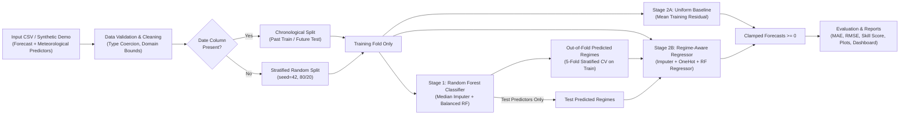

# Regime-Aware Post-Processing of Monsoon Rainfall Forecasts

**Problem Statement ID:** SIH26080  
**Organisation:** Ministry of Earth Sciences (MoES)  
**Project Group:** G26  

> **Synthetic Demonstration Notice:** Because no proprietary historical MoES/IMD forecast-observation dataset is bundled in this repository, the default execution mode generates a clearly labelled **synthetic demonstration dataset** (`data/demo_monsoon.csv`). Results reported below demonstrate end-to-end software behavior and regime-aware methodology only; they are **not** real meteorological findings. Quality-controlled historical numerical weather prediction (NWP) forecasts, surface observations, and domain-validated monsoon phase labels are required for scientific validation.

---

## Abstract

Raw numerical weather prediction (NWP) rainfall forecasts during the Indian summer monsoon frequently exhibit systematic biases that vary substantially across synoptic monsoon phases. In particular, **Active** monsoon phases (enhanced convective activity and monsoon trough strengthening) and **Break** monsoon phases (suppressed convection and northward trough shift) often show biases of opposite sign or different magnitude. Applying a single uniform bias correction across all days can cancel opposing errors in aggregate while degrading forecasts within individual regimes.

This project implements a two-stage, leakage-safe machine learning post-processing system in Python and Scikit-learn. Stage 1 classifies each forecast day into **Active**, **Break**, or **Other** regimes using meteorological predictors available at forecast issuance time. Stage 2 learns regime-conditioned forecast residuals using out-of-fold predicted regimes during training and predicted regimes during inference, clamping corrected rainfall to non-negative values. The pipeline benchmarks **Raw Forecasts**, **Uniform Bias Correction** (mandatory baseline), and **Regime-Aware Bias Correction** across overall and regime-specific MAE, RMSE, and Skill Scores, exposed through an interactive Streamlit dashboard.

---

## Problem Background

Operational rainfall forecasts often require statistical post-processing (Model Output Statistics / residual bias correction) to correct systematic NWP model errors caused by convective parameterization limits, orographic effects, and synoptic-scale moisture biases. However, a global mean bias correction assumes error stationarity across weather regimes:

- During **Active** spells, models may systematically under-predict heavy convective rainfall totals.
- During **Break** spells, models may systematically over-predict light or spurious rainfall.
- Averaging positive and negative residuals produces a small global offset that fails to fix—and can actively worsen—regime-specific forecast errors.

Conditioning residual correction on the predicted monsoon regime directly addresses this non-uniform error structure.

---

## Objectives

1. **Regime Identification:** Predict the monsoon regime (`Active`, `Break`, `Other`) prior to rainfall post-processing using predictors available at forecast time.
2. **Baseline Comparison:** Implement and compare:
   - Raw rainfall forecast
   - Uniform bias correction (mean training residual baseline)
   - Regime-aware residual correction (proposed two-stage approach)
3. **Comprehensive Evaluation:** Quantify and visualise overall and regime-stratified **Mean Absolute Error (MAE)**, **Root Mean Squared Error (RMSE)**, **Skill Score** relative to raw forecasts, and **regime classification metrics** (accuracy, precision, recall, F1-score, confusion matrix).

---

## Proposed Methodology & System Architecture



### Leakage Prevention Safeguards

- **Training-only statistics:** Median imputers, one-hot encoders, and the uniform baseline's mean training residual (`observed_rainfall - rainfall_forecast`) are computed strictly on training data.
- **Out-of-fold Stage 1 stacking:** During training, the Stage 2 residual regressor receives 5-fold out-of-fold regime predictions (`cross_val_predict`) rather than overfitted in-sample classifier predictions.
- **Strict test-time isolation:** Test predictions never access true test-set `regime` labels or `observed_rainfall`. True test `regime` labels are used solely *after* prediction to compute per-regime evaluation breakdowns.
- **Chronological splitting:** When a `date` column is provided in real datasets, `split_data()` automatically sorts chronologically and holds out future dates to prevent temporal leakage.

---

## Machine Learning Algorithms

| Component | Algorithm / Method | Details |
|---|---|---|
| Missing Value Handling | `SimpleImputer(strategy="median")` | Fitted strictly on training predictors inside Scikit-learn `Pipeline`s |
| Stage 1: Regime Classifier | `RandomForestClassifier` | 250 trees, `max_depth=12`, `min_samples_leaf=3`, `class_weight="balanced"`, `random_state=42` |
| Stage 2A: Uniform Baseline | Mean Training Residual | Adds $\bar{r}_{\text{train}} = \text{mean}(y_{\text{train}} - \hat{y}_{\text{raw,train}})$ and clamps to $\ge 0$ |
| Stage 2B: Regime-Aware Model | `ColumnTransformer` + `RandomForestRegressor` | Numeric imputer + `OneHotEncoder` on `predicted_regime` + 300-tree RF (`max_depth=14`, `min_samples_leaf=4`), added to raw forecast and clamped to $\ge 0$ |

---

## Dataset Description

### Expected Schema (`data/monsoon_data.csv`)

| Column | Description | Role |
|---|---|---|
| `date` *(optional)* | ISO date (`YYYY-MM-DD`); enables chronological holdout split | Temporal index |
| `rainfall_forecast` | Raw NWP rainfall forecast (mm/day) | Predictor & raw baseline |
| `temperature_anomaly` | Surface/air temperature anomaly (°C) | Predictor |
| `humidity` | Relative humidity (%, valid range 0–100) | Predictor |
| `wind_speed` | Wind speed (m/s, $\ge 0$) | Predictor |
| `pressure_anomaly` | Surface pressure anomaly (hPa) | Predictor |
| `rainfall_lag_1d` | Previous day's observed rainfall (mm/day, $\ge 0$) | Predictor |
| `rainfall_lag_3d` | Previous 3 days' rainfall (mm/day, $\ge 0$) | Predictor |
| `observed_rainfall` | Observed rainfall (mm/day, $\ge 0$) | Regression target |
| `regime` | Monsoon phase (`Active`, `Break`, `Other`) | Classification target |

If `data/monsoon_data.csv` is absent and no `--data` path is passed, `train.py` generates `data/demo_monsoon.csv` (2,400 synthetic samples with illustrative regime-dependent biases).

---

## Repository Structure

```text
monsoon-regime-aware-forecasting/
├── data/
│   └── README.md                 # Data placement & schema notes (CSV files gitignored)
├── models/                       # Saved joblib model bundle (gitignored)
├── notebooks/
│   └── README.md                 # Space for exploratory notebooks
├── reports/                      # Generated metrics JSON, test CSV, and PNG charts (gitignored)
├── src/
│   ├── __init__.py
│   ├── data_preprocessing.py     # Schema validation, cleaning, demo generator, chronological/stratified split
│   ├── regime_classifier.py      # Stage 1 Random Forest pipeline & OOF prediction helper
│   ├── bias_correction.py        # Uniform baseline & Stage 2 regime-aware residual pipeline
│   └── evaluation.py             # MAE, RMSE, Skill Scores, classification metrics, Matplotlib plots
├── tests/
│   └── test_pipeline.py          # Automated pytest suite covering preprocessing, models, metrics, E2E
├── app.py                        # Multi-tab interactive Streamlit dashboard
├── train.py                      # Reproducible CLI training & evaluation script
├── requirements.txt              # Python dependencies
├── .gitignore
└── README.md
```

---

## Installation

```bash
git clone https://github.com/Sinan-mhd/monsoon-regime-aware-forecasting.git
cd monsoon-regime-aware-forecasting

python -m venv .venv
# Windows (PowerShell):
.venv\Scripts\Activate.ps1
# Linux/macOS:
# source .venv/bin/activate

pip install -r requirements.txt
```

---

## Execution & Testing

### 1. Train & Evaluate the Pipeline

Run with automatic synthetic demonstration data (if `data/monsoon_data.csv` is absent):

```bash
python train.py
```

Run with your own dataset:

```bash
python train.py --data data/monsoon_data.csv --split auto --test-size 0.2 --random-state 42
```

Generated outputs:
- `models/monsoon_models.joblib` — Serialized classifier, residual pipeline, feature list, and uniform training offset
- `reports/metrics.json` — Complete classification, regression, skill score, and per-regime evaluation report
- `reports/test_predictions.csv` — Row-level test-set predictions across all three approaches
- `reports/mae_comparison.png`, `reports/rmse_comparison.png`, `reports/regime_performance.png`, `reports/confusion_matrix.png`, `reports/actual_vs_predicted.png`

### 2. Run Automated Tests

```bash
pytest -v
```

### 3. Launch the Interactive Dashboard

```bash
streamlit run app.py
```

The Streamlit dashboard provides:
- **Overview & Architecture:** Project motivation, two-stage workflow, and leakage safeguards
- **Dataset & Regime Classification:** Cleaning report, class distribution, per-class P/R/F1, and confusion matrix
- **Bias Correction Comparison:** Overall and per-regime MAE, RMSE, and Skill Scores plus sample test predictions
- **Visualisations:** All five generated Matplotlib evaluation figures
- **Sample Prediction Interface:** Interactive feature inputs and scenario presets returning predicted regime probabilities, raw forecast, uniform correction, and regime-aware correction

---

## Evaluation Metrics

- **Mean Absolute Error (MAE):** $\frac{1}{n}\sum_{i=1}^{n} |y_i - \hat{y}_i|$
- **Root Mean Squared Error (RMSE):** $\sqrt{\frac{1}{n}\sum_{i=1}^{n} (y_i - \hat{y}_i)^2}$
- **Skill Score (vs. Raw Forecast):**
  $$\text{Skill Score} = 1 - \frac{\text{Error}_{\text{corrected}}}{\text{Error}_{\text{raw}}}$$
  Computed separately for MAE and RMSE. **Positive values ($> 0$)** indicate error reduction relative to raw forecasts; **$0$** indicates no change; **negative values ($< 0$)** indicate degradation.
- **Regime Classification Metrics:** Accuracy, macro/weighted precision, recall, F1-score, and 3×3 confusion matrix across `Active`, `Break`, and `Other`.

---

## Synthetic Demonstration Results

> **Disclaimer:** These results were produced on the synthetic demonstration dataset (`data/demo_monsoon.csv`, 2,400 rows, 80/20 stratified split, `random_state=42`) to verify software behavior. They do not represent real forecast skill on IMD/MoES observations.

### Regime Classification (Test Set, $n = 480$)

- **Overall Accuracy:** `0.9417` (`94.17%`)
- **Macro Precision / Recall / F1:** `0.9410` / `0.9423` / `0.9415`

| Regime | Precision | Recall | F1-Score | Support |
|---|---|---|---|---|
| Active | 0.9820 | 0.9535 | 0.9676 | 172 |
| Break | 0.9252 | 0.9577 | 0.9412 | 142 |
| Other | 0.9157 | 0.9157 | 0.9157 | 166 |

### Overall Forecast Error & Skill Score

| Approach | MAE (mm/day) | RMSE (mm/day) | MAE Skill Score | RMSE Skill Score |
|---|---|---|---|---|
| Raw Forecast | 11.24 | 14.01 | 0.000 | 0.000 |
| Uniform Bias Correction (`+2.87` mm/day) | 11.07 | 13.63 | +0.015 | +0.027 |
| **Regime-Aware Correction** | **5.68** | **7.22** | **+0.495** | **+0.485** |

### Performance by Monsoon Regime

| Regime ($n$) | Raw MAE | Uniform MAE | Regime-Aware MAE | Uniform MAE Skill | Regime-Aware MAE Skill |
|---|---|---|---|---|---|
| Active (172) | 16.54 | 14.16 | 6.64 | +0.144 | +0.599 |
| Break (142) | 10.22 | 12.70 | 4.67 | **-0.243** | **+0.543** |
| Other (166) | 6.61 | 6.47 | 5.54 | +0.021 | +0.162 |

Notice how in the synthetic demonstration, uniform bias correction degrades **Break** phase forecasts (MAE increases from `10.22` to `12.70` mm/day, skill `-0.243`) because the global positive offset (`+2.87` mm/day) reinforces Break-phase over-forecasting, whereas regime-aware correction improves every regime.

---

## Limitations

- The bundled `make_demo_data()` generator creates illustrative synthetic relationships and is not a physical atmospheric model.
- Real-world operational deployment requires quality-controlled historical forecast archives (matched to forecast issuance lead time) and meteorological observations.
- Active/Break monsoon phase definitions vary by region (e.g., Central India monsoon core zone vs. all-India rainfall indices) and must be grounded in an accepted MoES/IMD definition for real experiments.
- Random Forest residuals provide point estimates without calibrated prediction intervals.

---

## Future Improvements

- Integrate real historical NWP forecast and gridded/station observation archives with multi-year chronological cross-validation (leave-one-monsoon-season-out).
- Add quantile regression or conformal prediction intervals for probabilistic rainfall post-processing.
- Incorporate spatial coordinates, lead-time embeddings, and synoptic circulation indices (e.g., 850 hPa zonal wind, OLR).
- Compare against climatology and quantile-mapping baselines alongside uniform additive bias correction.

---

## Attribution Note

No external datasets or third-party papers are bundled or cited without direct verification. When replacing the synthetic dataset with real MoES/IMD records, document dataset provenance, spatial domain, temporal coverage, and regime-labelling methodology in `data/README.md` and this README.
